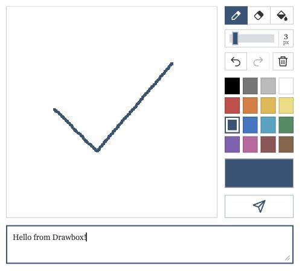
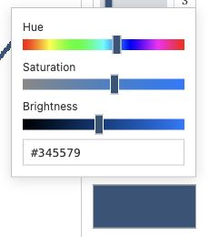

# DrawBoxCFL

A drawing box for your website. Visitors can leave a drawing and a little message, and you can receive both privately through Cloudflare (or by email if you want).

This is based on vv0ltz’s Drawbox, with Cloudflare Workers and D1 handling the storage. It has a pen, eraser, fill tool, undo/redo and a custom color picker.



<details><summary>Custom color picker</summary>



</details>

## Setup

You’ll need Node.js 22.13+, a Cloudflare account, and access to edit your website. There’s a bit of setup the first time, but after that you mostly just edit the three Drawbox files.

For a walkthrough with screenshots, see [Cloudflare setup](docs/CLOUDFLARE.md).

Start with:

```sh
npm ci
npx wrangler login
npx wrangler d1 create canvas-drawings
npm run setup
```

Setup asks for your website address and the Database ID, then fills in the config files. Leave the Worker address blank if you haven’t deployed yet. It saves copies of the previous settings in `.setup-backups/` and never asks for secret keys.

Continue with [step 4 of the Cloudflare guide](docs/CLOUDFLARE.md#4-create-the-worker) to deploy, save your Worker address, add an inbox key, and upload the website embed. Each step includes a short check so you know it worked. You don’t need to edit the backend code.

Get your first drawing into the inbox before adding optional email delivery.

## Try the example

Download `examples/preview.html` (use **Download raw file** on GitHub), then open the saved file to try the drawing tools. It is self-contained, so it does not need the project folders or a build first. Sending is disabled in this example; use the website embed above for real submissions.

## Make it your own

| File | Purpose |
| --- | --- |
| drawbox.html | Canvas, controls and SVG icons |
| drawbox.css | Colors, spacing and responsive layout |
| drawbox.js | Drawing, picker, message and send behavior |
| config.json | Website and Worker origins |
| backend/ | Worker, database, email and tests |

After editing, run `npm test`, then `npm run deploy`. Existing Google Forms/Imgur drawings are not imported automatically. Email stays off until you set it up.

## Optional features

- [Email drawings to yourself](docs/EMAIL.md)
- [Read and save drawings in your browser](docs/INBOX.md)
- [Backend API and limits](docs/API.md)
- [Security and maintenance](docs/SECURITY.md)

The browser inbox lets you view drawings and save PNGs. Moving drawings to Trash or restoring them needs a private API client. Items in Trash are permanently removed after seven days. Keep the scheduled cleanup enabled, and check your Cloudflare and email limits before sharing the box widely.

## Development

`npm run build` generates the Worker and embed files. `npm test` runs local regression tests. `npm run dev` starts a local Worker; see [local preview](docs/DEVELOPMENT.md). Deployment and email need your own account settings.

Inspired by [vv0ltz/Drawbox](https://github.com/vv0ltz/Drawbox) and the original drawbox.nekoweb.org project. This version replaces the original frontend and backend with the Cloudflare implementation. Source is MIT licensed; dependencies keep their own licenses. See [LICENSE](LICENSE) and [third-party notices](docs/THIRD_PARTY_NOTICES.md).
