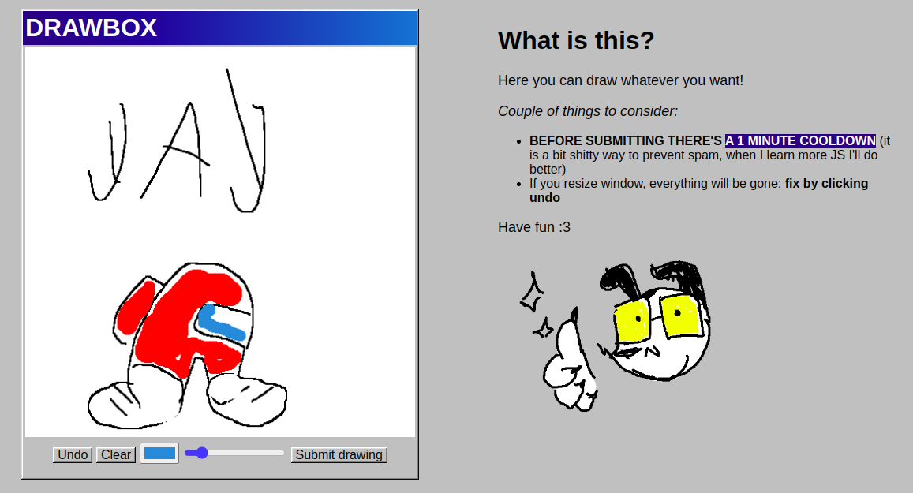

# Introduction

This is a fork of a drawbox for static sites made by [drawbox.nekoweb.org (archive)](https://web.archive.org/web/20250311101048/https://drawbox.nekoweb.org/)

It relies on **Google Forms/Sheets and Imgur** as a backend and was designed with **Neocities** and **Nekoweb** users in mind

I decided to publish it because:
- I made it mobile responsive
- Included basic cooldown funcition that makes user have to wait a minute before submitting an image
- It got deleted by the author and I want to preserve it

If you use **Neocities**, it will **NOT** work for new free tier accounts (old ones are fine) due to the [Content Security Policy](https://content-security-policy.neocities.org/). **Nekoweb** users should be fine

## A live example is found [here](https://vv0ltz.neocities.org/draw) and on [archive](https://web.archive.org/web/20260815002812/https://vv0ltz.neocities.org/draw)

---

# Current Problems and Moderation

Current project is simple and free, however, *it exposes your forms and sheet IDs*. The sheet is unaffected since it's view only, but as long as your forms are open - anyone can submit whatever through the forms itself, so improvements are appreciated.

**Moderation:**

- To delete a drawing - go to the drawbox sheet and delete a row with a corresponding imgur link
- To close the uploads to the gallery - close the drawbox form 

---

# How To Set Up

You need a Google account and these files from this repo:

- **drawbox.html** - this is where the actual drawbox itself is.
- **drawbox.js** - this is the code that saves the image
- **drawbox.css** - makes the site itself prettier, feel free to change

In the `drawbox.js` file you need to provide 4 variables.

Create a google forms. You can call it whatever you like. Add a "short answer" question. I called mine "imgur link". Press the 3 dots up next to your pfp. press "pre-fill form". It will open a new tab in which your blank google form will be presented to you. Input something into the form and tap "get link". Copy the link and open it up in a notes app, here's an example:

`https://docs.google.com/forms/d/e/1FAIpQLScbzFT1pxeIkp5yNB3fB7VD9V89Jbitr4h30Q3jXYjy54SlMQ/viewform?usp=pp_url&entry.251336726=imgur`

You then want to go back to the edit page of your form and click "responses". Click "link to sheets" and create a sheet.

## GOOGLE_FORM_ID

The long string of text is your google form URL. From the example above, it's this one:

`1FAIpQLScbzFT1pxeIkp5yNB3fB7VD9V89Jbitr4h30Q3jXYjy54SlMQ`

## ENTRY_ID

Your entry id will be formatted along the lines of this; from the example above it's: 

`entry.251336726`

## GOOGLE_SHEET_ID

Navigate to your responses on your google form and press "view in sheets". once on your sheet, press "share" and change General access to "anyone with link", and copy you should get something similar to the below:

`https://docs.google.com/spreadsheets/d/16jUCXXinqztl3sFftpWur9yFCAiASDsvmIsF3xHv-BU/edit?usp=sharing`

copy your ID (in this case `16jUCXXinqztl3sFftpWur9yFCAiASDsvmIsF3xHv-BU`) and paste it into the GOOGLE_SHEET_ID variable

## DISPLAY_IMAGES

Simply set this to true or false depending if you wish to display your images on your page or not.

Thats it! if youve set up everything correctly, it should work. 

