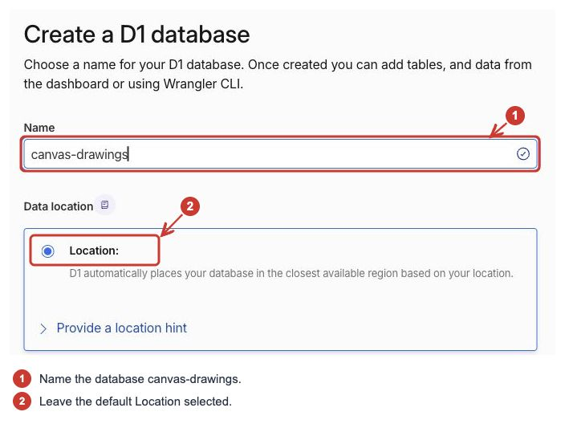
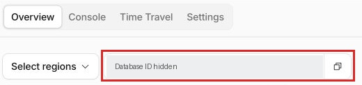
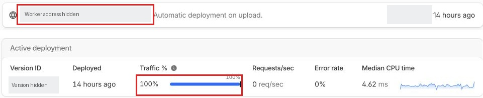
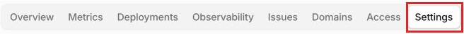
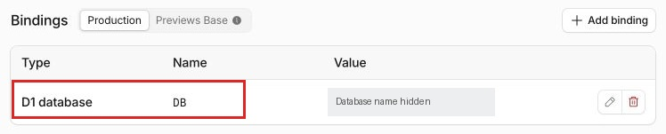
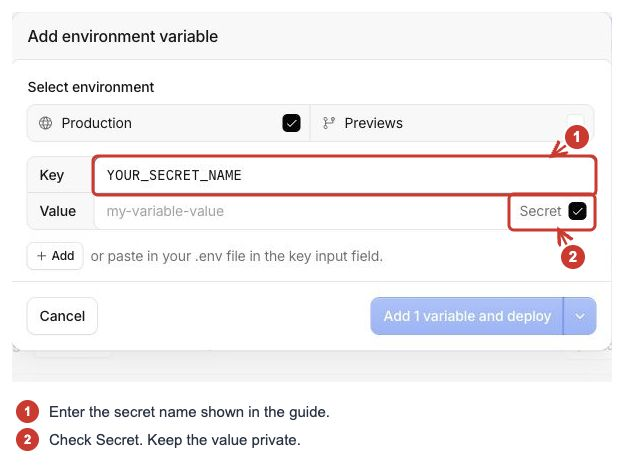
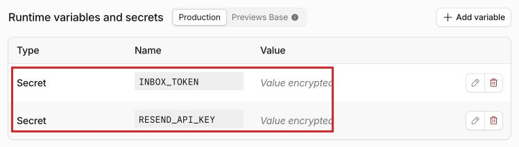
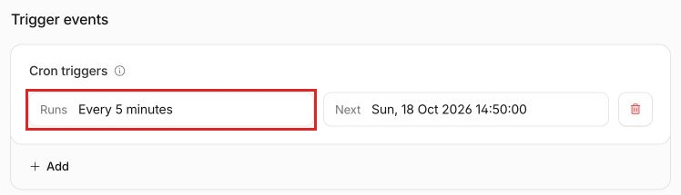
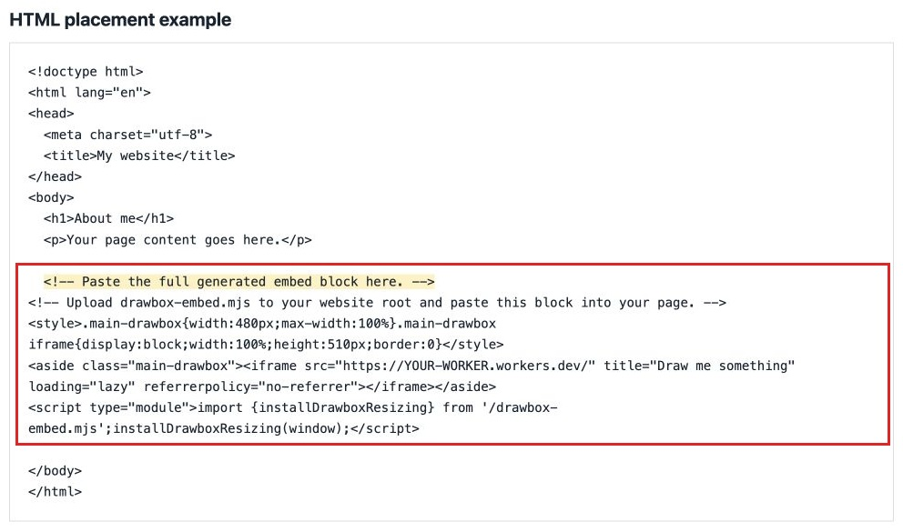
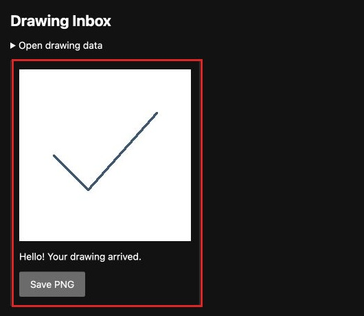

# Connect DrawBoxCFL to Cloudflare

You’ll need two things on Cloudflare: a Worker to receive drawings and a D1 database to store them. This guide walks through setting those up and adding DrawBoxCFL to your website.

## 1. Install the project tools

Download and unzip the project, then open a terminal in its folder. You’ll need Node.js 22.13 or newer.

```sh
npm ci
npx wrangler login
```

Wrangler is Cloudflare’s command-line tool. It opens a browser for you to sign in. Once you’re signed in, return to the terminal.

## 2. Create the D1 database

In the [Cloudflare dashboard](https://dash.cloudflare.com/), open **Storage & databases → D1 SQLite Database → Create Database**. You can also find D1 through the dashboard search.



1. Name it **canvas-drawings**.
2. Leave the default **Location** selected unless you need another region.
3. Scroll down and click **Create**.

Open the database’s **Overview** tab. Its **Database ID**, also called its **UUID**, sits above the charts. Click the copy button beside it:



Save that ID for the next step. If you already created a database using the README’s `wrangler d1 create` command, use that one.

## 3. Connect the database and choose a Worker name

Open `backend/wrangler.jsonc` in a text editor. These are the fields to change:

```json
"name": "canvas-drawbox",
"d1_databases": [
  {
    "binding": "DB",
    "database_name": "canvas-drawings",
    "database_id": "PASTE_YOUR_DATABASE_ID_HERE"
  }
]
```

Change these fields in the existing file and leave the rest as it is.

- **name** is the Worker’s name. Keeping `canvas-drawbox` is fine.
- **database_name** must match the database you created.
- **database_id** is the ID you just copied. Keep the quotes around it.
- **binding** must stay **DB**. That is how the code finds the database.

Add the tables to your new database:

```sh
npx wrangler d1 execute canvas-drawings --remote --file backend/schema.sql --config backend/wrangler.jsonc
```

Use your database name in the command if you changed it.

## 4. Create the Worker

Run:

```sh
npm run deploy
```

This builds the project and creates your Worker. Wrangler handles the upload, so there’s no code to paste into the dashboard. It may ask you to select your account or choose a workers.dev subdomain.

When deployment finishes, copy the Worker address it prints. It will look like:

```text
https://canvas-drawbox.YOUR-SUBDOMAIN.workers.dev
```

You can find the same address at the top of the Worker’s **Overview** tab. To check the deployment, open **Deployments** and look under **Active deployment**:



The screenshot shows an existing deployment, with its address hidden. Copy your own Worker address from the terminal or dashboard.

The Worker now exists, but it still needs your website address and inbox key before it can receive drawings.

You can now find the Worker under **Workers & Pages** in the dashboard. Open it, then choose **Settings** in the top row:



Scroll to **Bindings**. It should show a **D1 database** with the binding name **DB** and your database selected. Wrangler adds this from the config file.



Check that the selected database is the one you created in step 2.

## 5. Connect your website

Open `config.json` and replace both example addresses:

```json
{
  "allowedOrigins": ["https://your-site.example"],
  "workerOrigin": "https://canvas-drawbox.YOUR-SUBDOMAIN.workers.dev"
}
```

For **allowedOrigins**, use your website address without a trailing slash or page path. For example, use `https://your-name.neocities.org`, not a link to a post. Add another address only if you use that website too.

For **workerOrigin**, paste the Worker address you copied, also without a trailing slash.

## 6. Add your private inbox key

Generate a long random password in your password manager. Save it, then run:

```sh
npx wrangler secret put INBOX_TOKEN --config backend/wrangler.jsonc
```

Paste the password when Wrangler asks for the secret value. You’ll use this key to open your private inbox, and the Worker needs it before accepting drawings. Keep it out of your website and public files.

You can add it from the dashboard instead, under **Workers & Pages → your Worker → Settings → Runtime variables and secrets → Add variable**:



Enter **INBOX_TOKEN** in the name field shown as `YOUR_SECRET_NAME`, turn on **Secret**, and paste your password into the value field. Save it when you’re done.

You should now see **INBOX_TOKEN** listed as **Secret**, with **Value encrypted** beside it. The **RESEND_API_KEY** entry is only needed if you want email delivery.



Run the deployment command again to apply your website settings:

```sh
npm run deploy
```

## 7. Check the Worker settings

Open your Worker’s **Settings** in Cloudflare:

- **Bindings:** D1 should be connected as **DB**.
- **Runtime variables and secrets:** **INBOX_TOKEN** should be stored as a secret. Its value should not be visible.
- **Trigger events → Cron triggers:** keep `*/5 * * * *`. This runs cleanup and optional email retries every five minutes. The config adds it for you.

Under **Trigger events**, check that **Runs** says **Every 5 minutes**. If it’s already there, you’re set. The next run time will depend on when you check.



You can also open `https://YOUR-WORKER-ADDRESS/health`. A response containing `"ok":true` confirms the database check worked. It does not confirm that email is configured or delivered.

Opening the Worker address by itself shows a blank page. The drawing box is set up to appear inside your website.

## 8. Add DrawBoxCFL to your website

The build creates `website-files/`:

1. Upload **drawbox-embed.mjs** from that folder to your website root, beside your main HTML file.
2. Open **embed.html** in a text editor and copy its contents.
3. Paste that block into your website’s HTML where you want the drawing box, then upload the edited page.

Place the block inside your page’s `<body>`, after the content you want above it and before `</body>`. Here is a basic placement example:



The red box shows where the embed goes. Copy it from your own `website-files/embed.html` so it uses your Worker address.

Keep both the iframe and its script. The script gives the color picker and expanding message box enough room.

Visit the page on your actual website and send a small drawing. Confirm it appears in the [private inbox](INBOX.md). A received drawing should appear with its optional message and a **Save PNG** button:



This example shows a test drawing received through a local Worker. Check that the drawing you sent from your website appears in your inbox too.

If you want drawings by email too, follow the [Resend guide](EMAIL.md).

## If something does not work

- **Blank on your website:** check that `allowedOrigins` matches its address exactly. Your host must also allow the Worker iframe and the script.
- **Database error:** check the database ID, the **DB** binding and that you ran the schema command.
- **Service not configured:** make sure **INBOX_TOKEN** is saved on the correct Worker.
- **Clipped message box:** upload the sizing module and keep its script with the iframe.
- **Please wait before sending again:** that is the cooldown. Your drawing stays there so you can send it later.
- **Works locally but not online:** after changing an address or source file, deploy again and upload the newly generated website module and embed block.

Use `examples/preview.html` to try the tools without setting up a backend. Sending is disabled there. For visitors to send drawings, use the generated website embed.

More detail: [Cloudflare’s D1 setup guide](https://developers.cloudflare.com/d1/get-started/), [Worker deployment guide](https://developers.cloudflare.com/workers/get-started/guide/) and the project’s [API and limits](API.md).
