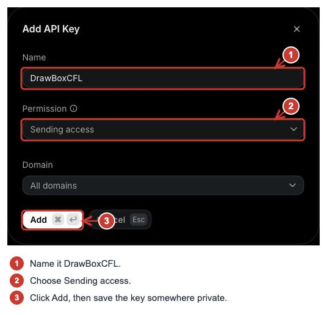

# Get drawings by email

Email is optional. DrawBoxCFL already saves drawings in Cloudflare, so you can set this up later. With email enabled, each accepted drawing is sent with the subject **drawing**, the image, and the visitor’s message if they wrote one.

Finish the [Cloudflare setup](CLOUDFLARE.md) first.

## 1. Create a Resend key

Sign in to [Resend](https://resend.com/) and verify your account’s email address. Open **API keys → Create API key**.



1. Name it **DrawBoxCFL** so you can recognize it later.
2. Change the permission to **Sending access**. If you have a verified sending domain, you can restrict the key to that domain.
3. Click **Add**, then copy the new key into your password manager. Keep it private; it is not something to upload with your website.

No real key is shown in the screenshot.

## 2. Choose where the email goes

Open `backend/wrangler.jsonc` and find `vars`. Set `MAIL_TO` to your own email address:

```json
"vars": {
  "MAIL_TO": "you@example.com",
  "MAIL_FROM": "drawing <onboarding@resend.dev>"
}
```

Replace `you@example.com` with your address. Leave `MAIL_FROM` as shown if using Resend’s test sender. That sender can only send to the address associated with your Resend account. To send elsewhere, verify a domain you own in Resend and use an address from that domain as `MAIL_FROM`.

The recipient is controlled by your Worker settings. Visitors cannot change it.

## 3. Connect the key to Cloudflare

Run these commands from the project folder:

```sh
npx wrangler secret put RESEND_API_KEY --config backend/wrangler.jsonc
npm run deploy
```

Paste the Resend key into Wrangler’s private prompt. Do not add it to the JSON file. If you prefer the dashboard, use the [Cloudflare secret form](CLOUDFLARE.md#4-add-the-database-tables-and-private-key) with the name **RESEND_API_KEY** and **Secret** enabled.

That connects the key and applies your email settings.

## 4. Try it

Send a small drawing from your website. Check your inbox and spam folder. In Resend, open **Emails** to see whether the email was accepted, delivered or rejected.

If it fails, the drawing is still saved in your private Cloudflare inbox. A successful send in the drawing box confirms storage, not email delivery.

The most common setup issue is using the test sender with a different recipient. Check that `MAIL_TO` is your Resend account’s address, or use a verified sending domain. Also check that both `MAIL_TO` and `RESEND_API_KEY` are set.

## A few things to keep in mind

Drawings and messages pass through Resend when email is enabled, so let visitors know in your site’s privacy notice. Check the provider’s current allowance before opening the box to lots of visitors.

The Worker queues email and retries temporary failures. It allows up to **90 attempts per UTC day**, including retries; extra jobs wait. After five failed attempts, a permanent rejection, or a 23-hour retry window, a job needs review rather than retrying forever. Repeated attempts reuse the same delivery key to help prevent duplicate emails. These are project limits, not a promise about your Resend plan.

To turn email off, set `MAIL_TO` to an empty string and redeploy. Drawings will still be saved. Removing a drawing from Cloudflare does not recall an email already delivered.

More detail: [Resend’s sending-key permissions](https://resend.com/docs/api-reference/api-keys/create-api-key) and [test-sender restrictions](https://resend.com/docs/knowledge-base/403-error-resend-dev-domain).
